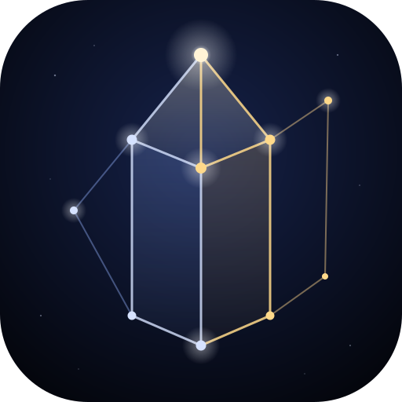
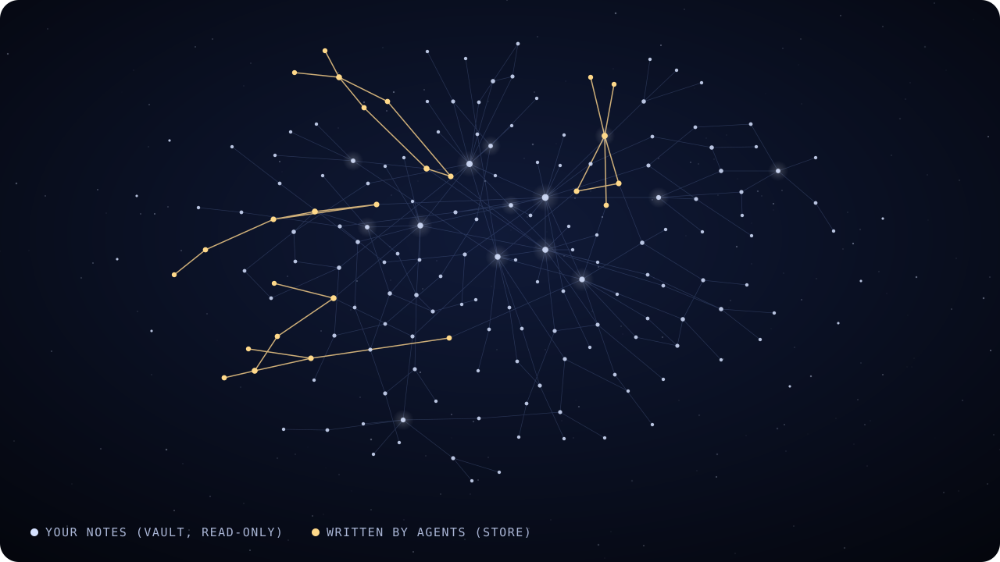

<p align="center">
  
</p>

<h1 align="center">Quartzite</h1>

<p align="center">
  A knowledge base you share with your AI agent:<br>
  your Obsidian notes, plus a space your agent writes into.
</p>

## If you use Obsidian, you know most of this

A folder of markdown, `[[wikilinks]]`, backlinks, a graph of how your notes
connect. Quartzite keeps all of that and adds what an AI agent needs:

- **A write API.** Your agent creates, edits and renames documents over HTTP.
  Renaming rewrites the links that point at it, so nothing rots.
- **Documents that aren't just markdown.** A document can be an HTML page, a
  chart, or a small interactive app with its own scripts and assets.
- **Broken links as a to-do list.** A link to a note that doesn't exist yet
  isn't an error. The dashboard counts them, so you can see what's left to write.

<p align="center">
  
</p>

## Your vault stays yours

Point Quartzite at your Obsidian vault and it reads and links your notes, but
never writes them. New writing, yours or your agent's, goes into a separate
folder, the **store**.
Both show up in one graph and one search.

Keep the two apart: don't point the store and the vault at the same folder,
and don't put a link inside the store that leads into your vault. The details
are in [docs/architecture.md](docs/architecture.md#the-vault-is-read-only).

## Get started with Claude Code

Quartzite is a small Go program you build from source. The easiest way is to
let your agent do it. Paste this into Claude Code:

> Clone https://github.com/bachittle/quartzite, build it, and run it with my
> Obsidian vault at `~/path/to/vault` as the read-only vault.

Then open <http://localhost:5003>. The repo's [AGENTS.md](AGENTS.md) tells your
agent how to build and run it.

<details>
<summary>Or by hand</summary>

You need [Go](https://go.dev/dl/) 1.26 or newer (`brew install go` on a Mac).

```
git clone https://github.com/bachittle/quartzite
cd quartzite
go build -o quartzite ./cmd/quartzite
./quartzite -vault ~/path/to/vault
```

Without `-vault`, it runs with the store alone. The store is created at
`./store` on first run, with a Welcome document to start from. Port taken?
Add `-addr :5004`.

</details>

## What to ask your agent next

- *"Read docs/api.md, then write a note about this week's work that links to
  my notes on it."*
- *"Make an interactive page that explains how my notes on X fit together."*
- *"Find everything that links to my note on Y and summarize it in a new note."*

Leave the browser open while it works. The dashboard updates live as documents
land.

## Not there yet

There is no graph view in the app yet, and no editing in the browser. Keep
writing in Obsidian; Quartzite picks up your changes within a few seconds.

## Going deeper

- [docs/architecture.md](docs/architecture.md): how the store, vault, documents,
  links and viewers work, and where the code lives.
- [docs/api.md](docs/api.md): every endpoint, with examples, and the protocol
  documents use to talk to the app.
- [AGENTS.md](AGENTS.md): rules for agents (and people) changing the code.

## License

MIT. See [LICENSE](LICENSE).
